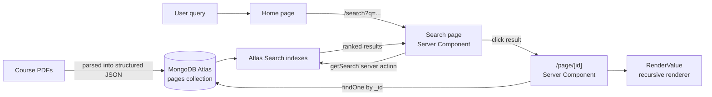

# CS391 Course Search Engine

A full-stack search engine that turns a semester of lecture slides and course PDFs into a single, searchable knowledge base. Type a concept like "flexbox" or "server components" and get ranked results across every lecture, then open any result to read the full structured content.

Built as the final project for **CS391 (Web Application Development)** at Boston University.

---

## The Problem

Course material lives in dozens of slide decks and PDFs. Finding where a topic was covered means opening files one by one and scrolling. This app centralizes all of it behind one search box.

## Features

- **Full-text search across all course material**, powered by MongoDB Atlas Search with relevance scoring
- **Schema-flexible indexing**: every lecture's JSON has a different shape, so search uses a wildcard path to match text in any field, at any depth
- **Google-style results page** showing each match's source document and a content preview
- **Dynamic document pages** that recursively render arbitrarily nested JSON (objects, arrays, primitives) into readable sections
- **Google sign-in** via Auth.js (NextAuth v5) with session-aware header
- **Server-side data access** using React Server Components and Server Actions, so database credentials never reach the browser

## How It Works



1. **Ingestion**: Lecture PDFs were converted to structured JSON documents and loaded into a MongoDB Atlas collection.
2. **Search**: `lib/getSearch.ts` runs an Atlas Search `$search` aggregation with a wildcard path (`*`) so queries match text in any field. It queries each configured search index, projects the title, preview text, and relevance score, and returns the merged results.
3. **Results**: `app/search/page.tsx` reads the `q` query parameter on the server and renders result cards linking to each document.
4. **Detail view**: `app/page/[id]/page.tsx` fetches the document by `_id` (with an `ObjectId` fallback for mixed ID types) and renders every content field through the recursive `RenderValue` component.

## Tech Stack

| Layer | Technology |
|---|---|
| Framework | Next.js 16 (App Router), React 19 |
| Language | TypeScript |
| Styling | Tailwind CSS 4 |
| Database | MongoDB Atlas |
| Search | MongoDB Atlas Search |
| Auth | Auth.js / NextAuth v5 with Google OAuth |

## Project Structure

```
├── app/
│   ├── page.tsx                  # Home page with search bar
│   ├── search/page.tsx           # Search results (server component)
│   ├── page/[id]/page.tsx        # Full document view
│   ├── about/page.tsx            # About page
│   └── api/auth/[...nextauth]/   # Auth.js route handlers
├── components/
│   ├── Header.tsx                # Logo + Google sign-in/out
│   ├── Footer.tsx
│   └── RenderValue.tsx           # Recursive JSON renderer
├── lib/
│   └── getSearch.ts              # Atlas Search query (server action)
├── types/                        # Shared TypeScript types
├── auth.ts                       # Auth.js configuration
└── db.ts                         # Cached MongoDB client + collection helper
```

## Getting Started

### Prerequisites

- Node.js 20+
- A MongoDB Atlas cluster with a `cs391-final-project` database and a `pages` collection
- A Google OAuth client ID and secret ([Google Cloud Console](https://console.cloud.google.com/apis/credentials))

### 1. Clone and install

```bash
git clone https://github.com/AngelManson/cs391-Project.git
cd cs391-Project
npm install
```

### 2. Configure environment variables

Create a `.env.local` file in the project root:

```bash
MONGO_URI=mongodb+srv://<user>:<password>@<cluster>.mongodb.net/
AUTH_SECRET=<generate with: npx auth secret>
AUTH_GOOGLE_ID=<your Google OAuth client ID>
AUTH_GOOGLE_SECRET=<your Google OAuth client secret>
```

Add `http://localhost:3000/api/auth/callback/google` as an authorized redirect URI in your Google OAuth client.

### 3. Create the Atlas Search indexes

In the Atlas UI, create search indexes on the `pages` collection named `default`, `default_1`, and `default_2` (these names are referenced in `lib/getSearch.ts`). Dynamic mapping works for schema-flexible documents:

```json
{
  "mappings": { "dynamic": true }
}
```

### 4. Run the app

```bash
npm run dev
```

Open [http://localhost:3000](http://localhost:3000) and search for a course topic.

## Technical Highlights

- **Searching data with no fixed schema.** Each lecture produced JSON with different keys and nesting. Rather than force a common schema, search uses Atlas Search's wildcard path, and the detail page renders documents with a recursive component that handles any combination of objects, arrays, and primitives.
- **Connection reuse.** `db.ts` caches the `MongoClient` and `Db` instances at module level so server components don't open a new connection on every request.
- **Server-first architecture.** Database queries run only in Server Components and Server Actions. The only client components are the search form (for routing) and the auth header (for sign-in/out).

## Team

| Contributor | Contributions |
|---|---|
| **Cheyenne Mowatt** | Converted course PDFs to structured JSON and loaded them into MongoDB; researched and implemented the Atlas Search query layer (`getSearch.ts`); document detail page; footer |
| **Angel Manson** | Search results page; About page |
| **Esraa Sabr** | Home page search and routing; recursive `RenderValue` renderer |
| **Kaizia** | Google OAuth authentication with Auth.js; session-aware header |

## Future Improvements

- De-duplicate and re-rank results merged from multiple search indexes by score
- Highlight matched terms in result previews using Atlas Search `searchHighlights`
- Commit the PDF-to-JSON ingestion pipeline to the repo so the dataset can be rebuilt
- Add autocomplete and fuzzy matching for typos

## Acknowledgments

All course content was created by Professor Davoodi for CS391 at Boston University.
